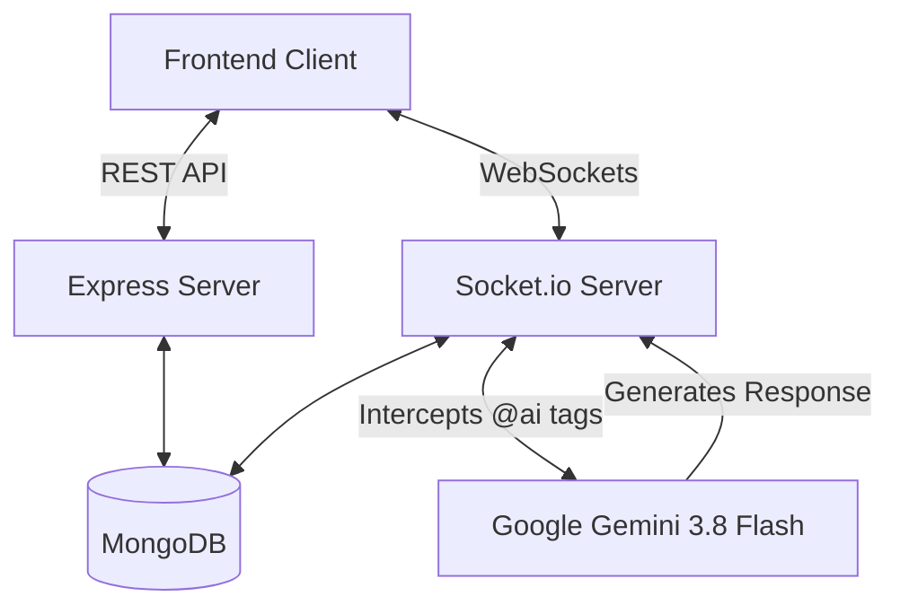
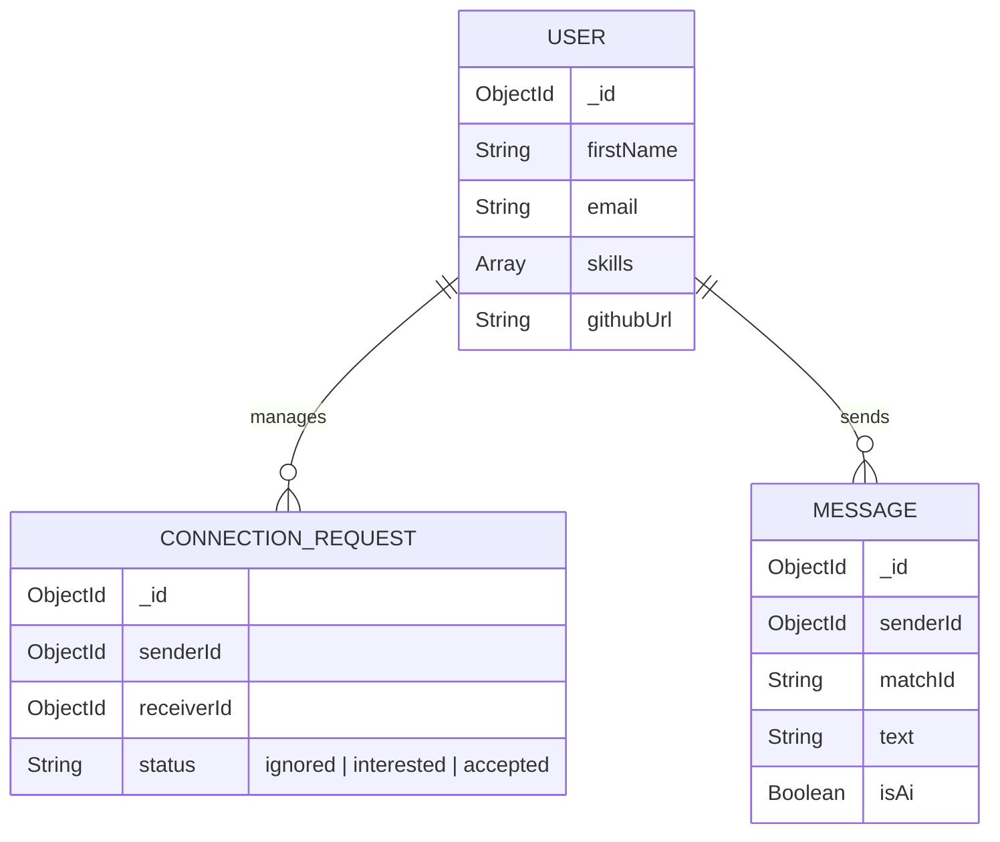

# SkillSync - Backend Services

**A Highly Scalable, Real-Time Networking Engine for Developers.**

  
  
  
  

---

## Executive Summary
**SkillSync** is the high-performance backend architecture powering a next-generation developer networking platform (often described as "LinkedIn meets Tinder for Developers"). 
It provides robust, secure RESTful APIs, real-time bidirectional communication via WebSockets, and natively integrated AI tooling.

This backend was engineered with **production-readiness** in mind, demonstrating strong understanding of API security, database modeling, and real-time scaling.

## Core Architecture & Features

### System Flow

### 1. Real-Time Socket Architecture
- **Bi-Directional Chat:** Instant message delivery using `Socket.io` with isolated private rooms generated securely per match.
- **Stateful Connections:** Efficiently tracks online status and manages socket disconnections to prevent memory leaks.
- **Context-Aware Event Emitting:** Validates premium constraints in real-time before broadcasting messages.

### 2. Gemini AI Integration
- **Native Chat Assistant:** Embedded `@google/genai` (Gemini 3.8 Flash) acts as a third participant in the chat.
- **Contextual Memory:** Intercepts `@ai` tags mid-stream, injects the previous message history as context, and returns beautifully formatted markdown.
- **Cost-Optimized:** Implements strict MongoDB `limit()` queries to fetch only necessary context, drastically reducing token consumption.

### 3. Security & Authentication
- **Stateless JWT Auth:** Secure cookie-based JWT authentication middleware.
- **Data Sanitization:** Strict Mongoose schemas and password hashing via `bcrypt`.
- **Protected Routes:** Enforced permission layers for all sensitive endpoints.

### 4. Monetization & Premium Flow (In Progress)
- **Feature Gating:** Backend natively intercepts WebSocket messages and API requests to enforce "Premium Request" limits.
- **Razorpay Integration:** Architectural foundation laid for payment processing to unlock full access.

### 5. Matchmaking & Connection Engine
- **Algorithmic Discovery:** Aggregates and filters user profiles to serve a relevant feed of potential connections based on tech stack.
- **State Machine Routing:** Manages the strict lifecycle of a connection request between developers (from `interested` to `accepted` or `ignored`).
- **Data Integrity:** Employs strict validation and MongoDB compound queries to ensure robust relationship mapping and prevent duplicate requests.

## Database Design (MongoDB)

- **Users:** Highly detailed schemas capturing developer stacks, portfolios, and github links.
- **ConnectionRequests:** Manages states (`ignored`, `interested`, `accepted`) with complex compound indexes.
- **Messages:** Optimized for time-series querying, including boolean flags for `isAi` messages.

---
*Built to showcase strong backend engineering fundamentals, API design, and modern real-time capabilities.*
