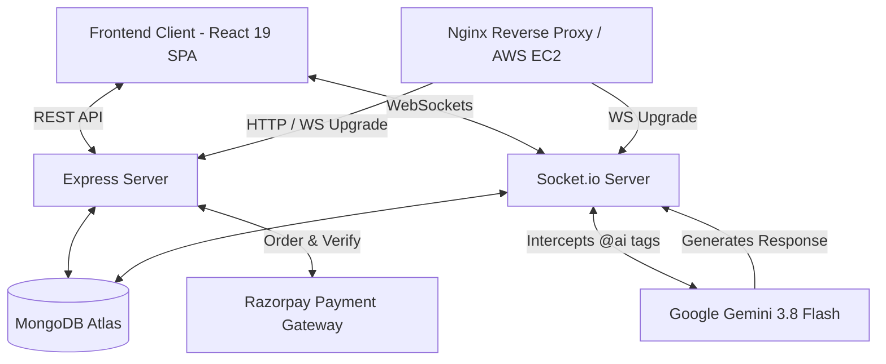
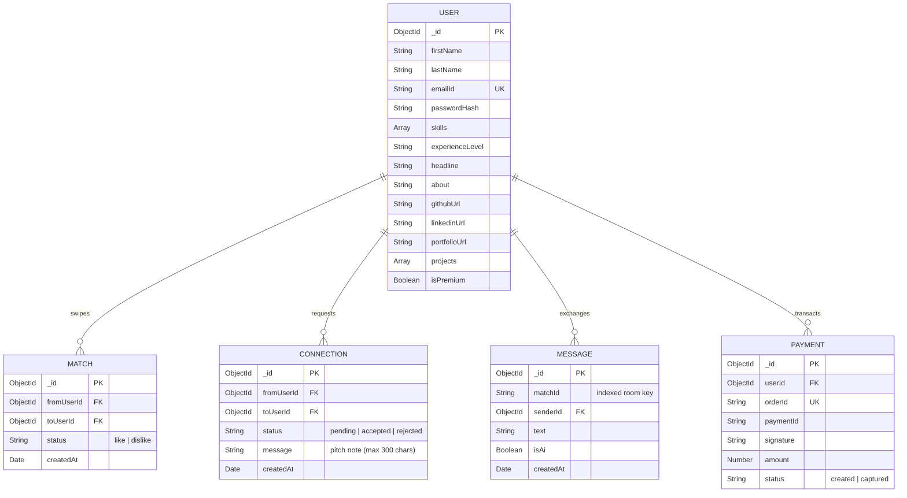

# SkillSync — Backend Services

**A Production-Ready, Real-Time Networking & AI Collaboration Engine for Developers.**

  
  
  
  
  
  
  

---

## Executive Summary
**SkillSync** is the high-performance backend architecture powering a developer matchmaking and networking platform (often described as *"LinkedIn meets Tinder for Developers with an AI Copilot"*). 

It provides robust, secure RESTful APIs, real-time bidirectional communication via WebSockets, natively integrated Google Gemini AI tooling, and a Razorpay payment gateway — engineered for production and deployed on **AWS EC2** with **Nginx** and **PM2**.

* **Frontend Repository:** [https://github.com/ani1911/SkillSync-frontend](https://github.com/ani1911/SkillSync-frontend)

---

## Platform Workflow (4-Stage Collaboration Lifecycle)

To ensure high-intent networking instead of superficial connections, SkillSync implements an intentional 4-stage collaboration lifecycle:

1. **Discover:** Developers browse a dynamic feed filtered by tech stack (MongoDB `$nin` aggregation excluding self, swiped, and connected users).
2. **Mutual Match:** Swiping "like" detects bidirectional interest, elevating both users to mutual matches.
3. **Connect with Pitch Note:** Developers send formal connection requests with an optional pitch note (up to 300 characters). Includes reverse-invite auto-accept resolution.
4. **Chat & @ai Copilot:** Accepted connections unlock real-time WebSocket messaging and in-chat Google Gemini AI pair programming.

---

## System Architecture

---

## Core Engineering Highlights

### 1. Real-Time Socket Architecture
- **Bi-Directional Chat:** Real-time messaging with `Socket.io` using private rooms generated deterministically (`[userA, userB].sort().join("_")`) to prevent duplicate threads and race conditions.
- **Persistence-First Pattern:** Messages are committed to MongoDB before broadcasting to the room, ensuring zero message loss during momentary network latency.
- **Stateful Connection Lifecycle:** Tracks presence and cleans up socket listeners on disconnect to prevent memory leaks.

### 2. Google Gemini AI Integration (`@ai`)
- **Native In-Chat Assistant:** Embedded Google Gemini (Gemini 3.8 Flash) acts as an intelligent collaborator directly within conversation threads.
- **Contextual Memory:** Intercepts `@ai` tags mid-stream, fetches recent conversation history from MongoDB as prompt context, and returns formatted code responses.
- **Token & Cost Optimization:** Restricted to accepted developer connections with bounded context windows to keep latency low.

### 3. Matchmaking & Double Opt-In Engine
- **Algorithmic Discovery:** Aggregates discoverable developers with indexed MongoDB `$nin` queries (excluding self, swiped profiles, and active connections).
- **Mutual Match State:** Detects bidirectional interest and elevates both profiles to the mutual match stage.
- **Pitch Notes & Edge Cases:** Allows sending personalized pitch notes (up to 300 characters), with automatic resolution if a reciprocal request already exists.

### 4. Monetization & Payment Verification (Razorpay)
- **Pro Membership Pass:** Backend handles order creation, status tracking, and tier upgrades.
- **HMAC Signature Verification:** Verifies payment authenticity using server-side HMAC-SHA256 signature audits before activating membership benefits.
- **Transaction Auditing:** Persists payment lifecycle records to ensure an immutable audit log.

### 5. Authentication & Data Protection
- **Session Security:** Stateless JWT authentication stored in secure `httpOnly` and `SameSite` cookies to protect session integrity.
- **Data Protection:** Strict Mongoose schema validation, field whitelisting on updates, and selective projections to prevent sensitive data exposure.
- **Access Control Middlewares:** Route-level authentication middlewares verifying token claims and populating authorized user context on privileged requests.

---

## Production Deployment & Infrastructure (AWS EC2)
- **AWS EC2 Linux Host:** Deployed on AWS EC2 with system-level process management and daemon monitoring via **PM2**.
- **Nginx Reverse Proxy:** Manages request routing, SSL/TLS termination, and WebSocket protocol upgrades (`Upgrade: websocket`).
- **Zero-Downtime Reliability:** Configured PM2 restart policies on system reboot or unexpected failures for continuous availability.

---

## Database Design & Data Architecture (MongoDB)

- **Users:** Comprehensive developer profiles with skills, experience level, portfolio, and Pro membership status.
- **Matches & Connections:** Relational states enforced with compound unique indexes (`{ fromUserId: 1, toUserId: 1 }`).
- **Messages:** Time-series chat records indexed by `matchId` with flags for Gemini AI responses.
- **Payments:** Audit trail for Razorpay transaction orders, payment IDs, and verification signatures.

---

## API Overview

| Module | Method | Endpoint | Description |
|---|---|---|---|
| **Auth** | `POST` | `/signup`, `/login`, `/logout` | User registration, authentication, and secure session management |
| **Profile** | `GET`, `PATCH` | `/profile/view`, `/profile/edit` | Retrieve and update profile details, technical skills, and links |
| **Discovery** | `GET` | `/feed` | Dynamic developer feed filtered by tech stack and exclusions |
| **Match** | `POST` | `/match/:action/:userId` | Swipe interactions (`like` / `dislike`) with mutual match detection |
| **Network** | `GET`, `POST` | `/connection/send/:userId`, `/user/connections` | Send pitch notes, review invites, and list connections |
| **Chat** | `GET` | `/chat/:targetUserId` | Retrieve conversation history for active connection |
| **Payment** | `POST` | `/payment/create-order`, `/payment/verify` | Razorpay order generation and cryptographic signature verification |

---

*Built to demonstrate clean backend engineering fundamentals, real-time distributed systems, AI integration, and production AWS cloud deployment.*
